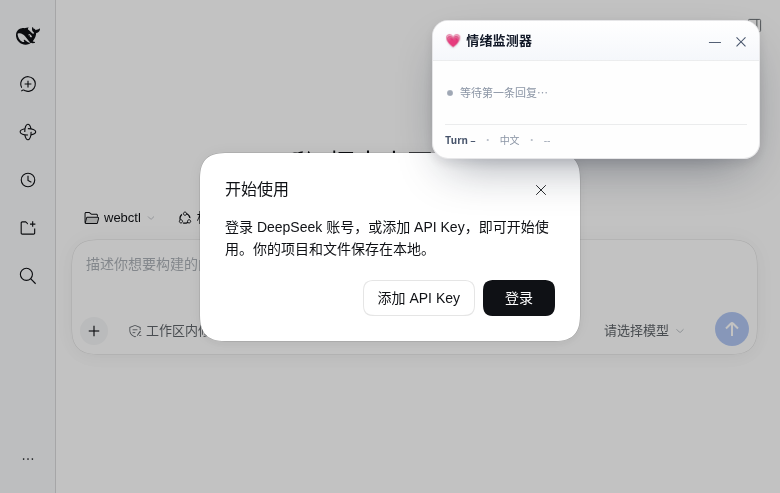

# dsh-emotion-analyzer

> DSH（DeepSeek Harness）情绪分析器插件：对主模型的每条回复做**本地**情绪打分，把累积情绪状态投影进 Session，并在 DSH 网站注入一个可拖拽的悬浮情绪监测框。

[](https://github.com/deepseek-ai/deepseek-harness)
[](LICENSE)
[](docs/model-export.md)
[](CONTRIBUTING.md)


## 功能

- **本地推理，零第三方模型 API**：XLM-RoBERTa-base 多语言情绪分类（11 标签多标签），ONNX INT8 动态量化，CPU 中位 **6.8ms/条**（p95 ≈ 8ms），不联网、不额外消耗主模型 Token。
- **多语言**：中文 / 英文原生支持（训练数据 20+ 语言），按 CJK 占比显示语言标识。
- **硬编码映射层**：11 个原始标签 → 7 个统一维度（happy/pleasant/sad/angry/anxious/unwell/neutral），阈值过滤 + 衰减 + 步长 + 封顶，参数集中在 `src/mapping.ts`。
- **Session projection**：每轮分数以 `plugin:emotion-analyzer/turn`（ignorable）写入会话日志，由 `emotion` projection 单元纯同步 fold；重启、fork 自动恢复。
- **悬浮框**：Web Components + Shadow DOM，演示态见下；拖拽、位置记忆、折叠 emoji 徽章、300ms 分数条动画、30 轮 canvas sparkline、明暗主题、关闭后设置页/右下角 💗 重开。

| 折叠徽章 | 暗色主题 | 真实 DSH 页面 |
|---|---|---|
|  |  |  |

## 架构（DSH 0.2.1-rc.2 实际 API）

```
agent/turn-stopping { agent, turn, signal }      ← 真实事件名（不是 turn-stopping）
  → 最后一条 assistant 的 text block
  → EmotionScorer.score(text)                    ← onnxruntime-node + INT8，惰性加载
  → appendPluginRecord(session, 'plugin:emotion-analyzer/turn', data)
  → ctx.sessionProjections.register({ key:'emotion', ... })   ← 纯同步 fold
  → Web 客户端 useProjection('emotion') → 模块 store
  → shell.overlay（root slot）→ React portal → <emotion-monitor>（Shadow DOM）
```

> 提示词里的 `turn-stopping` / `ctx.session.projection` / `ev.getLastMessage()` 与真实宿主不一致，完整校准表见 [docs/calibration.md](docs/calibration.md)。

## 安装

```sh
# 1) 先导出模型（权重不随仓库分发）
python3 -m venv .venv && . .venv/bin/activate
pip install -r scripts/requirements.txt
python3 scripts/export_model.py        # -> assets/model-int8.onnx + assets/tokenizer.json
python3 scripts/validate.py            # 40 句自验收，top-1 ≥ 80%

# 2) 装进 profile
dsh plugin --profile web add /path/to/dsh-emotion-analyzer
```

- 首次回复会触发模型加载（约 1.5s），之后单条 6–8ms；模型缺失时插件自动降级（不报错、不影响聊天）。
- `onnxruntime-node` / `tokenizers` 是原生模块，Windows/macOS 的安装脚本批准与二进制下载需在目标机验证（本机只验证了 Linux + Node 24）。

## 可调参数

都集中在 `src/mapping.ts` 顶部：

| 常量 | 值 | 说明 |
|---|---|---|
| `THRESHOLD` | 0.3 | 聚合分低于该值视为噪声：整轮跳过，不积累也不衰减 |
| `DECAY` | 0.85 | 每轮回落系数。**校准记录**：提示词给 0.9，但 0.9^10=0.349 无法满足"5 轮伤心 + 10 轮中性后 sad<0.2"，故取 0.85（见 [#13](https://github.com/Thatgfsj/dsh-emotion-analyzer/issues/13)） |
| `STEP_MAX` | 0.25 | 单轮命中最大步长，避免一次爆表 |
| `CAP` | 1.0 | 统一维度封顶 |

模型原始标签 → 统一维度映射见 `EMOTION_MAP`（`surprise` 暂不映射）。

## 验收结果

| 项 | 结果 |
|---|---|
| 20 中文 + 20 英文 top-1 | **40/40 = 100%**（阈值 80%） |
| CPU INT8 单条推理 | 中位 **6.8ms**，p95 ≈ 8.0ms（< 200ms） |
| tokenizer 与 Python fast 对齐 | 4/4 case 逐 token 一致 |
| 5 轮 sad 累积 / 10 轮 neutral 回落 | 单测通过（≤ CAP、< 0.2） |
| 重启 projection 恢复 | 日志重放回归测试通过 |
| 真实 DSH 页面悬浮框 | 展开/折叠/预览截图，0 console error |

完整矩阵与未验证项见 [docs/e2e.md](docs/e2e.md)。

## 文档

- [架构](docs/architecture.md)
- [DSH 宿主 API 校准](docs/calibration.md)
- [客户端集成（slot / portal / 设置开关）](docs/client-integration.md)
- [悬浮框（交互、主题、localStorage）](docs/widget.md)
- [模型导出与量化](docs/model-export.md)
- [端到端验收](docs/e2e.md)
- [贡献规则](CONTRIBUTING.md) · [AGENTS](AGENTS.md)

## 隐私

- 只把**助手回复文本**送进本进程内的 ONNX 推理；不联网、不调用第三方模型 API。
- 会话日志中的插件记录只含分数、语言、长度、FNV-1a 文本 hash 与时间，**不含回复原文**。
- 悬浮框趋势最多 30 轮（内存 + localStorage），不上传。

## License

- **代码**：MIT（见 [LICENSE](LICENSE)）。
- **模型权重**：上游 [tabularisai/multilingual-emotion-classification](https://huggingface.co/tabularisai/multilingual-emotion-classification) 为 **CC-BY-NC-4.0（非商业）**，本仓库不随源码分发权重，只提供下载/导出/量化脚本。商用前请自行评估或替换模型。
