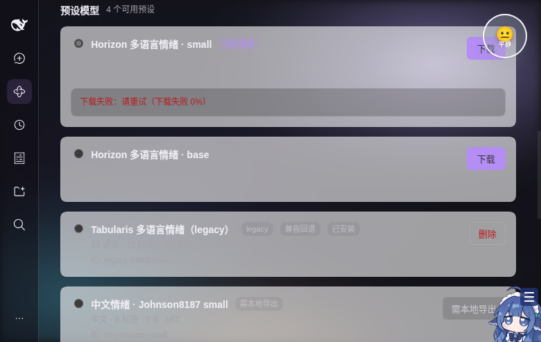

# Web 客户端集成

浏览器半边（`src/client/index.ts`）只使用 DSH 公开的 slot 系统，不 `require` 任何 `@deepseek-ai/dsh-client-*` 运行时包。

## 注册的 slot

| slot | scope | 作用 |
|---|---|---|
| `shell.overlay` | root（list） | 悬浮框；React portal 到 `document.body`，SPA 切换路由后仍在 |
| `conversation.session.header.utilities` | session（list） | 隐形桥：`useProjection('emotion')` → 模块级 store |
| `settings.general.item` | root（list） | Settings → General 的「显示情绪监测悬浮框」开关 |
| `plugins.bundle.config` | root（keyed，key=包名） | 插件管理页（Bundle 详情）内嵌完整设置区：显隐/重置 + 模型管理/下载/切换/测试（#50） |

插件详情页配置区（真实页面验证，v0.2.1）：


| `settings.section` | root（section） | Settings → 情绪分析器 / Emotion Monitor 页面：显隐/重置 + **模型管理区**（#40） |

`apply(ctx)` 里通过 `ctx.effect(() => ctx.slots.inject(name, () => ctx.slots.register(...)))` 注册，全部随插件 fiber 卸载自动清理（`inject` 回调返回合并 disposer）。

## 数据流

```
Host projection wire view
  → session 控制流 projection frame
  → 桥组件 useProjection('emotion')
  → store.publishEmotion(...)         （按内容去重，避免重复渲染）
  → shell.overlay 组件
  → React portal → <emotion-monitor>（Shadow DOM）→ element.update(data)
```

- 桥组件只在会话视图挂载时存在；悬浮框一直存在（root overlay），因此切换会话/打开设置页不会丢失。
- 没有收到任何投影数据时，widget 显示「等待第一条回复…」。

## 关闭 / 重开

- widget 内没有关闭 `[×]` 或悬浮重开按钮（#34）；显示/隐藏只由 Settings → 情绪分析器 / General 的开关控制，状态存 `dsh-emotion-analyzer.visible`，并通过 `emotion-analyzer-visibility` 事件广播。
- 折叠 `[—]`：回到 64×64 compact 徽章（emoji + 中文情绪，可拖拽）；点击徽章展开，没有 hover 自动预览；位置由 widget 自己持久化。

## 模型管理（#40）

设置页在「情绪分析器 / Emotion Monitor」分区内渲染模型区（`src/client/settings-models.ts`），数据来自同源宿主路由（`src/client/model-api.ts`）：

| 方法 | 路径 | 请求 | 响应 |
|---|---|---|---|
| GET | `/api/emotion-analyzer/v1/state` | — | `ModelState` |
| POST | `/api/emotion-analyzer/v1/model/select` | `{ id }` | `ModelState` |
| POST | `/api/emotion-analyzer/v1/model/download` | `{ id }` | `ModelState`（202，后台下载） |
| DELETE | `/api/emotion-analyzer/v1/model/{id}` | — | `ModelState`（下载中也用来取消） |
| POST | `/api/emotion-analyzer/v1/test` | `{ text }` | `ModelTestResult` |

所有请求 `credentials: 'include'`、同源；非 2xx 会解析 `{ error | message | detail }` 并包装成 `ModelApiError`（404/409/422/5xx 有中文兜底）。`ModelState` 的关键字段：

```ts
interface ModelState {
  current: ModelPreset | null
  presets: ModelPreset[]
  activeModelId: string | null
  download: ModelDownload | null   // status + 0-100 percent + bytes/speed/error
  needsExport: boolean            // 中文模型等需要本地导出
  fallback: boolean               // legacy 回退
  warnings: string[]
  source: 'live' | 'mock'
  mockReason?: string
}
```

模型卡片字段：`id/name/description/languages/languageCodes/labels/sizeBytes/license/profile/legacy/fallback/installed/downloadable/needsExport/recommended`；客户端对 `models|presets|available`、`sizeMiB/sizeMB`、`status:'installed'` 等别名做了容错归一化。

- **轮询**：检测到 `download` 为 `queued/downloading/verifying/installing` 时，`ModelApiClient.watchDownload` 每秒 GET `/state`，回调更新 UI；完成后自动停止，React effect 卸载时清理定时器。
- **UI**：当前模型卡（名称/语言/标签/体积/许可/legacy/fallback/needsExport）、预设卡片（radio 选择、下载、进度条、取消/删除）、测试一句（7 维分数条 + 耗时 + modelId + 错误）。下载中禁用其他选择/操作；所有异步路径 try/catch，失败只渲染内联错误，不会让 slot 渲染崩溃。
- **降级**：宿主路由尚未挂载（404/网络错误）时，auto 模式退回内置演示模型数据并在页面顶部标注「演示模式」；也可用 `?emotionModelMock=1` 强制演示数据、`?emotionModelLive=1` 强制 live。演示模式支持模拟下载进度、切换、删除与测试。
- **验证**：`tests/model-api.test.ts`（归一化/错误/轮询谓词/mock 下载流）与 `tests/settings-models.test.ts`（meta/badge/action/scoreRows/下载文案）；真实 DSH 页面探针确认插件已加载（`customElements.get('emotion-monitor')` 为 function、overlay 节点存在、插件清单列出「情绪分析器」），宿主模型路由尚未挂载时 UI 走演示模式；settings 面板的自动导航截图受当前 DSH 未登录欢迎弹窗限制，未截图。

## 构建

`src/client/index.ts` 由 `scripts/build.mjs` 用 esbuild 打成单个 CJS bundle，再包成：

```js
window.__ModuleLoader__.load({
  id: 'dsh-emotion-analyzer',
  factory(require) {
    var module = { exports: {} }
    // ...esbuild CJS 输出...
    return module.exports.default(require)
  },
})
```

`react` / `react-dom` 由宿主平台种子表提供；widget 源码（含 Shadow DOM 样式）被打进同一个 `lib/client.js`（minify 后 < 500 行）。

## 已知限制

- 设置开关是纯客户端偏好（localStorage），不写入 profile 配置；换浏览器/设备不同步。
- 多标签页共享 localStorage 的关闭状态，但每个标签页各自渲染一份悬浮框。
- 投影帧只在会话被打开（follow 流建立）后到达客户端；未打开过的历史会话不会主动拉取。
- 模型管理依赖 #39 的宿主路由；路由缺失时 UI 走演示模式，真实下载/切换/测试需要后端合并后验证。
