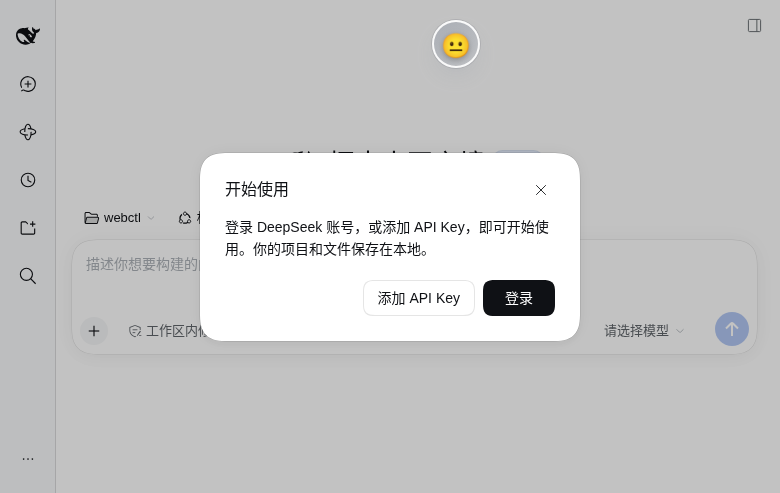

# 端到端与验收记录

> 环境：Linux（x86_64，i5-1240P，16 GB），Node 24.21，Python 3.13.5，DSH 0.2.1-rc.2，CPU INT8。
> 原则：只记录实际跑过的结果；未跑过的项明确标注。

## 验收矩阵

| 验收项 | 状态 | 证据 |
|---|---|---|
| 20 中文 + 20 英文 top-1 准确率 ≥ 80% | ✅ **40/40 = 100%** | `scripts/validate.py`（报告：zh 20/20、en 20/20，无 miss） |
| 单条推理 < 200ms（CPU INT8） | ✅ 中位 **6.8ms**，p95 ~8.0ms | `validate.py` 计时 + `tests/inference.test.ts` 真实模型用例 |
| tokenizer 与 Python fast tokenizer 逐 token 对齐 | ✅ 4/4 case ids/mask 完全一致 | `tests/fixtures/tokenizer-reference.json` + `tests/inference.test.ts` |
| 连续 5 轮 sad 单调上升且 ≤ CAP=1.0 | ✅ | `tests/mapping.test.ts`、`tests/projection.test.ts` |
| 之后 10 轮 neutral sad < 0.2 | ✅（DECAY 校准为 0.85，见 #13） | `tests/mapping.test.ts` 验收场景 |
| 推理异常不影响主流程 | ✅ init/score 全部降级为空对象 + 日志 | `tests/inference.test.ts`（缺失资产、run 抛错、logits 维度不符） |
| 进程重启后 projection 恢复 | ✅ 日志重放回归测试 | `tests/projection-restore.test.ts` + `tests/fixtures/session-restore-events.jsonl` |
| 悬浮框可拖拽/折叠/位置记忆/动画 | ✅ 真实 DSH 页面 + demo CDP | 本页截图、`docs/widget.md`、widget CDP 17 项断言 |
| Shadow DOM 隔离 | ✅ 恶意宿主 CSS demo + 真实页面 shadowRoot | `demo/index.html`、本页截图 |
| DSH 真实页面加载无 slot crash | ✅ 无 console error；元素正常升级 | 本页截图 + #20 |
| Host 插件真实加载 | ✅ `dsh --profile emo-test --help` EXIT 0；`import('dsh-emotion-analyzer')` 成功 | #17/#18 |
| 真实模型完整 turn（回复→打分→投影→UI） | ⚠️ **未在本机复跑**：本机 web 进程没有可用的 API key/账号路由（headless profile 报 `MISSING_CREDENTIAL`）。各段分别验证：推理真实模型测试、appendPluginRecord/投影 fold 回归、客户端 store 单测、真实页面挂载。 | 见下节 |

## 真实页面（emo-web profile + 合成会话日志）

用隔离的 `DSH_HOME=<isolated-dsh-home>` 启动 `dsh --profile emo-web --port 3099`，Headless Chrome CDP 加载真实页面：

- 展开态（等待第一条回复）：
- 折叠徽章（48×48，😐）：

CDP 断言（真实页面）：

| 断言 | 结果 |
|---|---|
| `customElements.get('emotion-monitor')` | function |
| `document.createElement('emotion-monitor')` | 不抛错，构造函数为自定义类，shadowRoot 存在 |
| portal 容器 `[data-dsh-emotion-analyzer]` | 1 个 |
| 元素尺寸（展开） | 328×139 |
| 点击折叠按钮 | `data-view=collapsed`、48×48、徽章 emoji 😐 |
| hover 徽章 | `data-preview=true`（220ms 预览） |
| 点击徽章 | 恢复 `data-view=expanded` |
| 页面 console | 修复 #20 后 0 个异常 |

## 未验证 / 已知限制

- 真实模型 turn 的端到端（需要用户配置可用的模型路由；本机测试环境无 API key）。
- Node 22 / Windows / macOS 下的 `onnxruntime-node`、`tokenizers` 安装未在本机复跑（仅 Linux + Node 24）。
- DSH 设置页的开关行只做了代码路径与注册验证，未在真实页面打开 Settings 截图。
- 多标签页、prefers-reduced-motion、隐私模式 localStorage 降级：代码已处理，未逐项截图。

## 0.1.1 用户反馈修复验证

| 项 | 结果 |
|---|---|
| 新增“疑问”维度 | 真实页面 widget 显示 8 条分数条，含「疑问 0%」；映射为 surprise 代理 |
| 关闭 → 重开 | 点击 [×] 后 widget 隐藏、出现「💗 情绪」按钮、localStorage visible=0；点击后 widget 恢复、visible=1 |
| slot 注册 | 真实页面 console 探针确认 `shell.overlay`、`settings.section`、`settings.general.item`、`conversation.session.header.utilities` 四个 inject 回调全部触发 |
| 控制台错误 | 0 |
