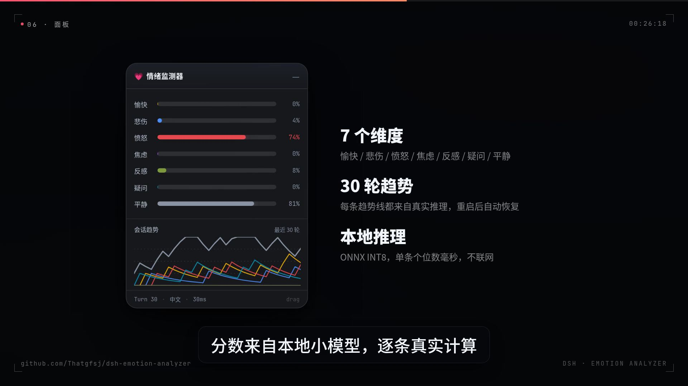

# 宣传片（Promo 2026-10）

面向社交平台的引流短片：**竖版 30 秒 × 3 个开场钩子 + 横版 45 秒**，中文烧录字幕、纯配乐无旁白。

> 点击封面播放横版 45 秒。竖版与其它变体见 [Release: promo-2026-10](https://github.com/Thatgfsj/dsh-emotion-analyzer/releases/tag/promo-2026-10)。

## 成片与用途

| 文件 | 规格 | 用途 |
|---|---|---|
| `promo30-A.mp4` | 1080×1920 / 30fps / 30s | 主投：小红书 / 抖音 / Shorts / X |
| `promo30-B.mp4` | 同上 | A/B 变体 |
| `promo30-C.mp4` | 同上 | A/B 变体 |
| `promo45.mp4` | 1920×1080 / 30fps / 45s | README / B站 / V2EX / 即刻 |
| `poster-16x9.jpg` / `poster-9x16.jpg` | 1920×1080 / 1080×1920 | 封面 / README 头图 |
| `promo30.srt` / `promo45.srt` | SRT | 平台字幕 / 无障碍 |

## 三个开场钩子（A/B 测试用）

| 版本 | 钩子 | 类型 |
|---|---|---|
| A | **AI 也会 emo 吗？** | 反常识提问（主投） |
| B | **我给 AI 装了个情绪手环。** | 自述 + 视觉隐喻 |
| C | **我把 AI 惹毛了。** | 现场演示 |

三条正片完全相同，只替换前 3 秒与结尾回环；发布后按 3 秒完播率保留赢家。

## 数据口径（不编数字）

- 片中的情绪分数（98% / 99% / 74% / 81%）由本仓库自带的 ONNX INT8 模型对 30 条真实风格回复**实际推理**得到，再按 `DECAY / STEP_MAX / CAP` 规则折叠趋势。
- 界面复刻的配色、尺寸、7 个情绪维度与文案取自 `src/widget/state.ts`、`src/widget/styles.ts`；不使用旧截图。
- 片中明确边界：**「读的是文字，不是内心（它没有）」**——分析对象是回复文本，不是模型内部状态。

## 发布建议

1. 竖版 A 先发小红书 / 抖音；B、C 作为同素材变体在 3–4 天内分发，比较 3 秒完播。
2. 横版发 B站 / X / V2EX / 即刻，标题用钩子句，置顶评论放仓库地址。
3. 结尾问题「你想让它读懂什么情绪？」用于引导评论；评论是这类视频的主要分发信号。
4. 同步提交到 DSH 生态清单（awesome-dsh-plugin 等）。

## 重剪

视频工程（Remotion）独立维护，不随本仓库分发；成片与字幕以 Release 资产为准。
