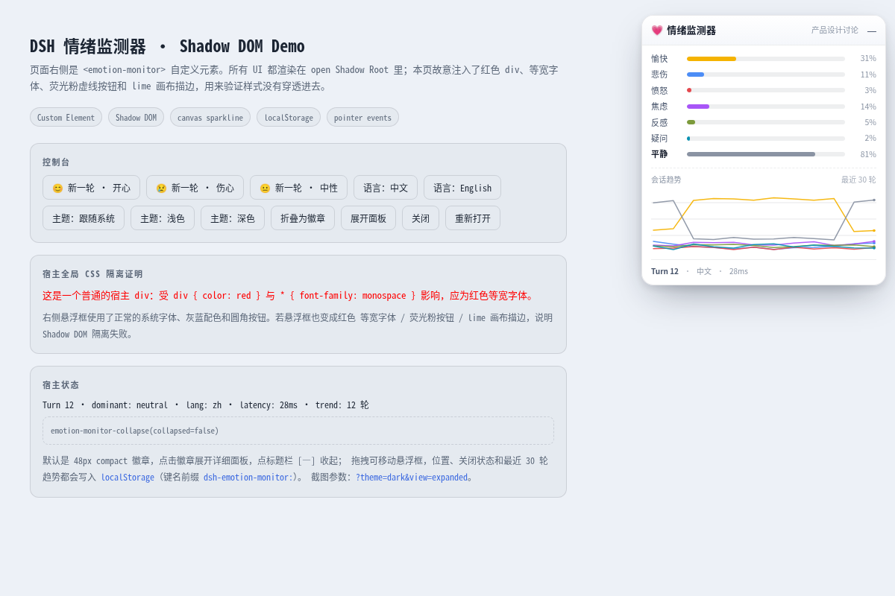
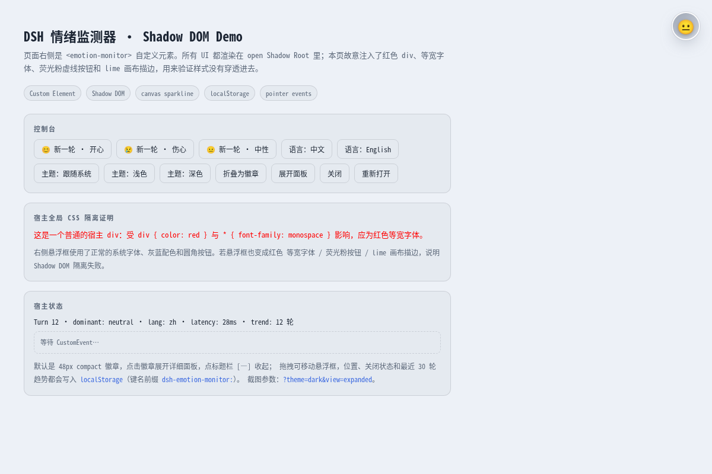
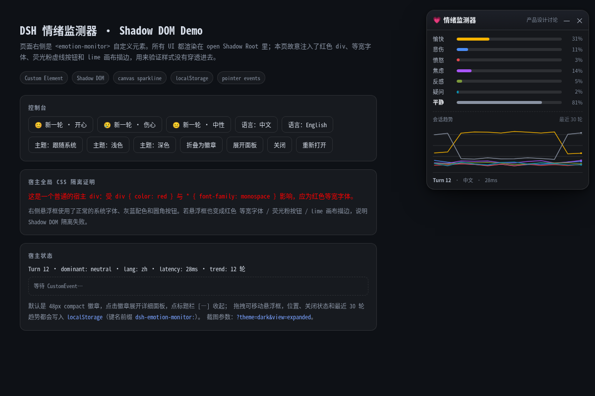

# 悬浮框 `<emotion-monitor>`

Shadow DOM 情绪悬浮框：**默认是 48px emoji 徽章，点击展开详细面板、再点 [—] 折叠**；可拖拽、30 轮 canvas 趋势线、明暗双主题，样式与宿主页面完全隔离（#31）。



| 折叠徽章（开心主导） | 暗色主题 |
|---|---|
|  |  |

> 截图由 headless Chrome 真实渲染；demo 页面故意注入了 `* { font-family: monospace }`、`div { color: red }`、荧光粉虚线按钮与 lime 画布描边，悬浮框不受影响。

## 快速预览

```sh
npm install --ignore-scripts
npm run build                       # -> demo/widget.iife.js
# 直接打开 demo/index.html，或：
google-chrome --headless=new --disable-gpu --no-sandbox \
  --screenshot=/tmp/widget.png --window-size=1200,800 \
  'file:///path/to/demo/index.html'
```

demo 支持 URL 参数，方便截图与排查：

| 参数 | 示例 | 含义 |
|---|---|---|
| `theme` | `?theme=dark` | `light` / `dark` / `system`（默认 system） |
| `view` | `?view=collapsed` | `collapsed` / `closed` / 默认展开 |
| `lang` | `?lang=en` | 初始语言标识 |
| `empty` | `?empty=1` | 保留「等待第一条回复」空状态，不灌 mock 历史 |

## 模块与行数

| 文件 | 职责 | 行数 |
|---|---|---|
| `src/widget/emotion-monitor.ts` | Custom Element、Shadow DOM、拖拽/折叠/关闭、rAF、localStorage | ~650 |
| `src/widget/state.ts` | 纯逻辑：归一化、主导情绪、emoji/颜色映射、CJK、趋势裁剪、采样、clamp、徽章渐变 | ~440 |
| `src/widget/styles.ts` | Shadow Root CSS 与明暗 token | ~460 |
| `src/widget/sparkline.ts` | canvas 2D 折线（无图表库） | ~130 |
| `src/widget/standalone.ts` | 注册元素 + `window.EmotionDemo` mock 驱动 | ~220 |
| `demo/index.html` | 可交互 mock demo + 恶意宿主 CSS 隔离验证 | ~300 |
| `tests/widget.test.ts` | node:test 纯逻辑单测（21 个用例） | ~320 |

所有文件 < 1000 行。widget 不执行 `document.body.appendChild`：宿主（DSH `shell.overlay` / React portal）负责把 `<emotion-monitor>` 放进 DOM。

## 宿主集成（与 #7 客户端桥的契约）

```ts
import { EmotionMonitorElement } from './widget/emotion-monitor.js'
// 模块导入即注册 <emotion-monitor>（幂等，可重复 import）

const element = document.createElement('emotion-monitor')
container.appendChild(element)                 // 由宿主决定挂载点
element.update({
  turn: 12,
  dominant: 'pleasant',
  scores: { pleasant: 0.84, sad: 0.05, angry: 0.02, anxious: 0.1, unwell: 0.04, confused: 0.01, neutral: 0.18 },
  trend: [{ pleasant: 0.7, /* ... */ }, { pleasant: 0.84, /* ... */ }],
  language: 'zh',
  latencyMs: 34,
  sessionId: 'session-xxx',
  sessionTitle: '产品设计讨论',              // 可选
})
```

- 外层 portal 容器可以是 `pointer-events: none` 的全屏层；元素在 `connectedCallback` 中自行设置 `position: fixed`、`pointer-events: auto`、`z-index`，不依赖外层布局。
- `customElements.define('emotion-monitor', EmotionMonitorElement)` 也可以在宿主里显式调用；widget 已通过 `defineEmotionMonitor()` 幂等注册。
- Shadow Root 为 `{ mode: 'open' }`，宿主可读取 `element.shadowRoot` 做断言，但不要修改内部节点。

### 公共 API

| 方法 | 说明 |
|---|---|
| `update(state)` | 接收一轮状态；内部合并为一次 `requestAnimationFrame` 渲染；可在未连接/关闭时调用 |
| `show()` | 从关闭态恢复显示；若之前处于关闭态会 dispatch `emotion-monitor-open` |
| `hide()` | 隐藏并持久化关闭态；dispatch `emotion-monitor-close` |
| `isClosed(): boolean` | 当前是否关闭 |
| `collapse()` / `expand()` | 程序化折叠/展开（不 dispatch collapse 事件，供宿主恢复 UI 状态） |

### state 形状

| 字段 | 类型 | 说明 |
|---|---|---|
| `turn` | `number` | 当前轮次，显示为 `Turn N` |
| `dominant` | `string` | 主导情绪；不合法或明显低于最高分时由 widget 按 scores 重新计算 |
| `scores` | `Record<string, number>` | 7 个维度：`pleasant/sad/angry/anxious/unwell/confused/neutral`；0–1，>1 按百分比解释（72 → 0.72），缺失补 0 |
| `trend` | `Array<Record<string, number>>` | 最近 30 轮，每项是 scores 映射；也兼容旧的 `{ scores }` 结构 |
| `language` | `'zh' \| 'en'` | 由宿主传入并原样展示；缺失时回退到 sessionTitle 的 CJK 占比判断 |
| `latencyMs` | `number` | 显示为 `34ms`；负数/缺失显示 `--` |
| `sessionId` | `string?` | 可选，原样带入事件 detail |
| `sessionTitle` | `string?` | 可选，标题栏右侧小字（超过 80 字符截断） |

若宿主不传 `trend`，widget 会把本轮 scores 追加到内存/localStorage 里的历史（最多 30 轮）；若 `turn` 回退（新会话），则从当前轮重新开始。

## 事件

| 事件名 | 触发 | `detail` | 冒泡/穿透 |
|---|---|---|---|
| `emotion-monitor-close` | 点击 `×` 或调用 `hide()` | `{ turn, sessionId? }` | `bubbles: true, composed: true` |
| `emotion-monitor-open` | 从关闭态调用 `show()` | `{ turn, sessionId? }` | 同上 |
| `emotion-monitor-collapse` | 用户点击折叠按钮 / 徽章 | `{ collapsed: boolean }` | 同上 |

宿主监听 close/open 来显示/隐藏右下角「💗 重开」按钮。

## 交互

- **拖拽**：标题栏 pointer events + `setPointerCapture`；移动过程实时 clamp 在 viewport 内（边距 12px），松手写入 localStorage。窗口 resize 后也会重新 clamp。
- **默认 compact / 展开**：默认 48px 圆形徽章，显示本回合主导情绪 emoji：pleasant 😊 / sad 😢 / angry 😠 / anxious 😟 / unwell 🤢 / confused 🤔 / neutral 😐；点击徽章展开详细面板，点标题栏 `—` 收起；背景是「主色 + 强度」的 145° 渐变与同色投影。
- **点击展开/收起**：点击徽章展开详细面板，点标题栏 `—` 收起；不再有 hover 自动预览（#31）。
- **关闭**：`×` 隐藏元素并写入 `closed=1`；宿主或 `show()` 恢复。
- **等待态**：尚未收到任何 `update` 时显示「等待第一条回复…」（不渲染空分数条与空折线）；收到第一轮后自动切换。
- **rAF 合并**：同一帧内多次 `update` 只渲染一次；分数条 `width` 使用 300ms `cubic-bezier(.22,.61,.36,1)` 过渡。
- **主题**：`prefers-color-scheme` 自动跟随；宿主可设置 `data-theme="light"|"dark"` 强制覆盖；`prefers-reduced-motion` 下关闭过渡与脉冲。
- **无障碍**：按钮有 `aria-label`，分数条为 `role="progressbar"` + `aria-valuenow`，徽章 `aria-label` 包含情绪与百分比，键盘可聚焦。

## localStorage

| 键 | 值 | 写入时机 |
|---|---|---|
| `dsh-emotion-monitor:position` | `{"x":852,"y":20}` | 拖拽结束 / 视口 clamp |
| `dsh-emotion-monitor:collapsed` | `"1"` / `"0"` | 折叠 / 展开 |
| `dsh-emotion-monitor:closed` | `"1"`（恢复时删除） | 关闭 / `show()` |
| `dsh-emotion-monitor:trend` | `[{"pleasant":0.84,...}, ...]` | 每次 `update`（最多 30 轮，分数保留 3 位小数） |

读取/写入均包在 try/catch 中：隐私模式或禁用存储时 widget 仍可工作，只是不记忆。关闭后重新打开页面会保持隐藏（`closed=1`），符合「设置里重开」的约定。

## 主题变量

Shadow Root 内自带完整默认值；宿主可在 `<emotion-monitor>` 上覆盖同名变量（外层声明优先于 `:host`），也可只依赖 `prefers-color-scheme`。

| 变量 | 浅色 | 深色 | 用途 |
|---|---|---|---|
| `--em-bg` | `rgba(255,255,255,.98)` | `rgba(22,24,29,.98)` | 面板背景 |
| `--em-titlebar` | 白→#f5f7fb 渐变 | #1d2028→#16181d 渐变 | 标题栏 |
| `--em-border` / `--em-divider` | 深色 10% / 8% | 白色 12% / 9% | 边框、分隔线 |
| `--em-text` | `#111827` | `#eef1f6` | 主文字 |
| `--em-text-secondary` | `#46536a` | `#b3bccb` | 标签、副文字 |
| `--em-text-muted` | `#8b95a5` | `#7f8a9b` | 数值、meta |
| `--em-track` | 深色 7% | 白色 10% | 分数条轨道 |
| `--em-shadow` | 蓝黑 42% 投影 | 纯黑 75% 投影 | 面板投影 |
| `--em-hover` / `--em-hover-danger` | 深色 6% / 红 12% | 白色 8% / 红 22% | 按钮 hover |
| `--em-focus` | `var(--dsw-alias-brand-primary, #4f7cff)` | 同左，兜底 `#7aa2ff` | 焦点环；唯一引用宿主 token 的地方 |
| `--em-grid` | 深色 10% | 白色 12% | sparkline 网格线 |
| `--em-empty` | 深色 34% | 白色 38% | 空趋势提示 |
| `--em-badge-ring` | 白色 92% | 白色 35% | 徽章内描边 |

情绪颜色（与分数条、折线一一对应）在 `src/widget/state.ts` 的 `EMOTION_META` 中定义：
pleasant `#F5B301`、sad `#4C8DF6`、angry `#E5484D`、anxious `#A855F7`、unwell `#7C9A3B`、confused `#0891B2`、neutral `#8A93A3`。

## Shadow DOM 隔离

- 全部 UI（含 `<style>`）都在 Shadow Root 内；宿主的全局 `div`/`button`/`canvas`/`*` 规则无法穿透。
- 字体显式写在 shadow 内部元素上（而不是依赖 `:host` 继承），因此 `* { font-family: monospace }` 不会改变面板字体。
- 布局关键属性（`position`、`left/top`、`width/height`、`display`、`pointer-events`、`z-index`）由元素自身以 inline style 兜底。
- 事件需要穿透 Shadow 边界时使用 `composed: true`。

## 测试与验收

```sh
npm run check      # tsc --noEmit + node --test（纯逻辑 21 个用例）
npm run build      # demo/widget.iife.js
```

**自动验证（headless Chrome 156 + CDP，无 puppeteer 依赖）**

- Shadow DOM：open shadow root、7 行分数条、面板字体 ≠ 宿主字体、标签颜色 ≠ 红、按钮 ≠ 荧光粉、canvas 无 lime 描边；
- 布局：无横向溢出、canvas 有 backing bitmap、300ms 过渡、meta 文本为 `Turn N · 中文 · 34ms`；
- 拖拽：真实 pointer 事件位移、位置写入 localStorage、拖到右下角被 clamp、窗口 resize 后仍在视口内；
- 折叠：48×48 徽章、😊 正确、渐变背景、`collapsed=1`、collapse 事件；
- hover 预览：220ms 后展开且面板不超出视口，移开收回；
- 关闭/重开：`display:none`、`closed=1`、close 事件；`show()` 恢复 + open 事件；
- 暗色：`prefers-color-scheme: dark` 下背景亮度 < 60；`data-theme="light"` 能反向覆盖系统暗色；
- 等待态：`等待第一条回复…`、分数/趋势隐藏、meta 为 `Turn – · 中文 · --`，首个 update 后切换；
- 全程 `Runtime.exceptionThrown` / `Log.entryAdded(error)` 为 0。

**代码路径验证（截图/自动化未覆盖）**

- 分数条 300ms 过渡的中间帧（只断言 `transition-duration` 与目标宽度，未逐帧截图）；
- 徽章 hover 放大动画、`prefers-reduced-motion` 分支；
- 隐私模式下 localStorage 抛错时的降级路径（try/catch）；
- 宿主 `--dsw-alias-brand-primary` 存在时的焦点环取色；
- 键盘 Tab 焦点（CSS `:focus-visible` 已实现，未做 axe 扫描）；
- 同页多实例：共享 storage keys，建议只挂一个。

**未验证/已知限制**

- 位置以 CSS px 记忆，浏览器缩放/多显示器 DPI 变化不会重新换算；
- 窗口小于面板尺寸时只能保证左上角 12px 边距，无法完整显示；
- 关闭状态是全局的，不区分 session；
- 折叠态 hover 预览会比页面内容优先，靠近边缘时会覆盖到左侧/上侧内容（已被视口 clamp）；
- 分数以整数百分比显示，`0.004` 会显示 `0%`；
- 依赖 Node ≥22.18（本机 24）运行 `.ts` 测试；旧 Node 20 需要 `--experimental-strip-types`。

## 截图复现

截图脚本使用 Node 内置 `WebSocket` 直连 Chrome DevTools Protocol（临时文件，不提交、不新增依赖）：

1. `npm run build`；
2. 启动 `google-chrome --headless=new --remote-debugging-port=0`；
3. 打开 `demo/index.html?theme=light`，等待渲染后 `Page.captureScreenshot`；
4. 通过 `Runtime.evaluate` / `Input.dispatchMouseEvent` 验证折叠、hover、拖拽、关闭与主题，并输出 `docs/screenshots/*.png`（每张 < 200KB）。

## 真实 DSH 页面验证（emo-web profile）

Headless Chrome CDP 在真实 DSH Web 页面验证：

- `<emotion-monitor>` 正常升级（修复前构造函数写宿主属性导致 `NotSupportedError`，页面只有 HTMLUnknownElement —— 见 #20）。
- 展开态截图：[real-page-expanded.png](screenshots/real-page-expanded.png)；折叠徽章截图：[real-page-collapsed.png](screenshots/real-page-collapsed.png)。
- 点击折叠 → `data-view=collapsed`、48×48、😐 徽章；hover 出现预览；点击徽章恢复展开。
